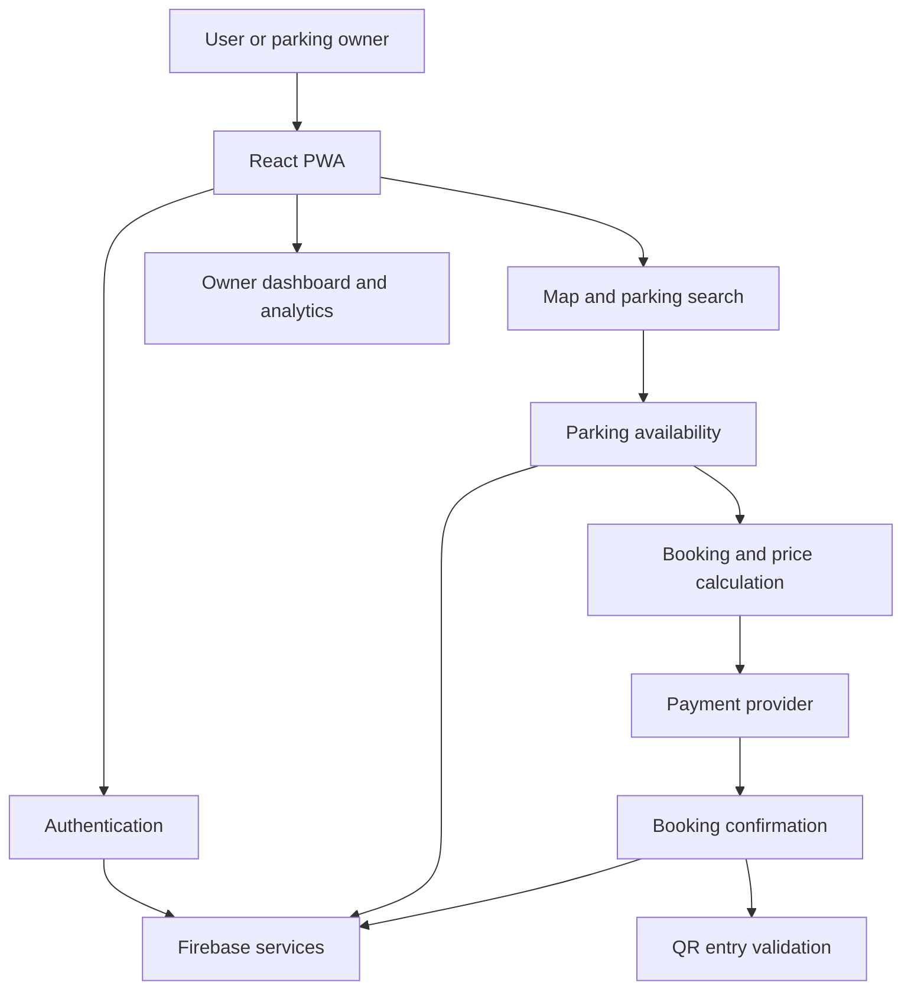

# Smart Parking Nepal - PWA


A production-ready Progressive Web Application for finding, booking, and managing parking spots in Nepal. Built with React, Firebase, and modern web technologies.

## 🚀 Features

### Core Features
- ✅ **Authentication** - Secure email/password login with user roles (User/Owner)
- 🗺️ **Interactive Map** - Real-time Google Maps integration with live location tracking
- 📍 **Smart Search** - Find nearby parking with distance calculation (Haversine formula)
- 📅 **Booking System** - Easy date/time selection with automatic price calculation
- 💳 **Payment Integration** - eSewa and Khalti payment gateways
- 📱 **QR Code** - Entry validation system for parking access
- 📊 **Owner Dashboard** - Manage parking spots and view analytics
- 📜 **Booking History** - Track all bookings with status filters
- ⭐ **Rating System** - Rate and review parking experiences
- 🔔 **Notifications** - Real-time booking updates

### Advanced Features
- 🌙 **Dark Mode** - Comfortable viewing in any lighting
- 📱 **PWA Support** - Installable on mobile devices
- 🔄 **Real-time Updates** - Live parking availability
- 🔒 **Secure** - Firebase security rules and data validation
- ⚡ **Fast** - Optimized performance and caching
- 📲 **Responsive** - Works on all devices

## Architecture



## 🛠️ Tech Stack

### Frontend
- **React 18.3** - UI framework
- **TypeScript** - Type safety
- **Tailwind CSS v4** - Modern styling
- **React Router v7** - Navigation
- **Radix UI** - Accessible components
- **React Google Maps** - Map integration
- **date-fns** - Date utilities
- **react-qr-code** - QR generation
- **Sonner** - Toast notifications

### Backend
- **Firebase Authentication** - User management
- **Cloud Firestore** - NoSQL database
- **Cloud Functions** - Serverless backend
- **Firebase Hosting** - Static hosting
- **Cloud Messaging** - Push notifications

### APIs
- **Google Maps JavaScript API** - Maps & geocoding
- **eSewa Payment API** - Digital wallet
- **Khalti Payment API** - Payment gateway

## 📁 Project Structure

```
smart-parking-pwa/
├── src/
│   ├── app/
│   │   ├── components/         # Reusable UI components
│   │   │   ├── ui/            # Radix UI components
│   │   │   ├── BookingCard.tsx
│   │   │   ├── ParkingCard.tsx
│   │   │   ├── QRCodeDialog.tsx
│   │   │   └── LoadingSpinner.tsx
│   │   ├── config/            # Configuration
│   │   │   └── firebase.ts
│   │   ├── contexts/          # React Contexts
│   │   │   ├── AuthContext.tsx
│   │   │   └── LocationContext.tsx
│   │   ├── screens/           # Page components
│   │   │   ├── LoginScreen.tsx
│   │   │   ├── MapScreen.tsx
│   │   │   ├── BookingScreen.tsx
│   │   │   ├── PaymentScreen.tsx
│   │   │   ├── HistoryScreen.tsx
│   │   │   └── OwnerDashboardScreen.tsx
│   │   ├── services/          # Business logic
│   │   │   ├── auth.service.ts
│   │   │   ├── firestore.service.ts
│   │   │   ├── booking.service.ts
│   │   │   ├── payment.service.ts
│   │   │   └── location.service.ts
│   │   ├── types/             # TypeScript types
│   │   ├── utils/             # Utilities
│   │   ├── App.tsx            # Root component
│   │   └── routes.tsx         # Routes
│   └── styles/                # Global styles
├── SETUP_GUIDE.md             # Detailed setup guide
├── ARCHITECTURE.md            # Architecture docs
├── CLOUD_FUNCTIONS.md         # Backend functions
└── README.md                  # This file
```

## 🚀 Quick Start

### Prerequisites

- Node.js 18+
- npm or pnpm
- Firebase account
- Google Cloud account (for Maps)
- Payment gateway accounts (eSewa/Khalti)

### Installation

```bash
# Clone the repository
git clone https://github.com/yourusername/smart-parking-nepal.git
cd smart-parking-nepal

# Install dependencies
npm install
# or
pnpm install
```

### Configuration

1. **Firebase Setup**
   - Create Firebase project at [console.firebase.google.com](https://console.firebase.google.com)
   - Enable Authentication (Email/Password)
   - Create Firestore database
   - Copy config to `/src/app/config/firebase.ts`

2. **Google Maps Setup**
   - Enable Maps JavaScript API
   - Create API key
   - Add key to `/src/app/screens/MapScreen.tsx`

3. **Payment Gateways**
   - Register for eSewa merchant account
   - Register for Khalti merchant account
   - Add credentials to `/src/app/services/payment.service.ts`

📖 **See [SETUP_GUIDE.md](./SETUP_GUIDE.md) for detailed instructions**

### Run Development Server

```bash
npm run dev
# or
pnpm dev
```

Open [http://localhost:5173](http://localhost:5173)

### Build for Production

```bash
npm run build
# or
pnpm build
```

## 🔐 Demo Accounts

For testing purposes:

**User Account:**
- Email: `user@test.com`
- Password: `user123`

**Owner Account:**
- Email: `owner@test.com`
- Password: `owner123`

## 📊 Database Schema

### Collections

#### users
```typescript
{
  uid: string;
  email: string;
  name: string;
  phone?: string;
  role: 'user' | 'owner' | 'admin';
  createdAt: Timestamp;
}
```

#### parking_spots
```typescript
{
  id: string;
  name: string;
  address: string;
  pricePerHour: number;
  latitude: number;
  longitude: number;
  totalSpots: number;
  availableSpots: number;
  ownerId: string;
  rating?: number;
  createdAt: Timestamp;
}
```

#### bookings
```typescript
{
  id: string;
  bookingId: string;
  userId: string;
  parkingId: string;
  startTime: Timestamp;
  endTime: Timestamp;
  totalAmount: number;
  paymentStatus: 'pending' | 'paid' | 'failed';
  bookingStatus: 'active' | 'completed' | 'cancelled';
  qrCode: string;
  createdAt: Timestamp;
}
```

## 🔒 Security

### Firebase Security Rules

```javascript
// Users can only read/write their own data
match /users/{userId} {
  allow read: if request.auth != null;
  allow write: if request.auth.uid == userId;
}

// Only owners can create parking spots
match /parking_spots/{spotId} {
  allow read: if true;
  allow create: if request.auth != null && 
                  get(/databases/$(database)/documents/users/$(request.auth.uid))
                    .data.role == 'owner';
}

// Users can only view their own bookings
match /bookings/{bookingId} {
  allow read: if request.auth.uid == resource.data.userId;
  allow create: if request.auth.uid == request.resource.data.userId;
}
```

## 🚀 Deployment

### Firebase Hosting

```bash
# Install Firebase CLI
npm install -g firebase-tools

# Login to Firebase
firebase login

# Initialize hosting
firebase init hosting

# Build and deploy
npm run build
firebase deploy --only hosting
```

### Vercel

```bash
# Install Vercel CLI
npm install -g vercel

# Deploy
vercel
```

### Netlify

```bash
# Install Netlify CLI
npm install -g netlify-cli

# Build
npm run build

# Deploy
netlify deploy --prod
```

## 📱 PWA Features

- ✅ Installable on home screen
- ✅ Works offline (limited functionality)
- ✅ Fast loading with service worker
- ✅ App-like experience
- ✅ Push notifications support

## 🧪 Testing

### Manual Testing Checklist

- [ ] User registration/login
- [ ] Map loads with location
- [ ] Parking spots display
- [ ] Booking creation
- [ ] Payment processing
- [ ] QR code generation
- [ ] Booking cancellation
- [ ] Owner dashboard
- [ ] Mobile responsiveness

### Automated Testing (Future)

```bash
# Unit tests
npm run test

# E2E tests
npm run test:e2e
```

## 📈 Performance

- ⚡ Lighthouse Score: 95+
- 🚀 First Contentful Paint: < 1.5s
- 📦 Bundle Size: < 500KB
- 🔄 Real-time updates: < 100ms latency

## 🤝 Contributing

Contributions are welcome! Please follow these steps:

1. Fork the repository
2. Create feature branch (`git checkout -b feature/AmazingFeature`)
3. Commit changes (`git commit -m 'Add AmazingFeature'`)
4. Push to branch (`git push origin feature/AmazingFeature`)
5. Open Pull Request

### Code Standards

- TypeScript for type safety
- ESLint for code quality
- Prettier for formatting
- Meaningful commit messages

## 📄 License

MIT License - see [LICENSE](LICENSE) file for details


## 🗺️ Roadmap

### Phase 1 (Current) ✅
- Basic booking system
- Payment integration
- Owner dashboard

### Phase 2 (Q2 2026) 🔄
- Advanced analytics
- Dynamic pricing
- Multi-language support
- iOS/Android native apps

### Phase 3 (Q3 2026) 📋
- IoT sensor integration
- AI-powered recommendations
- Subscription plans
- Corporate accounts

### Phase 4 (Q4 2026) 🚀
- Multi-city expansion
- Partner network
- Advanced booking algorithms
- Blockchain payments

**Made with ❤️ in Nepal**

*Solving parking problems, one spot at a time.*

---

## ⚠️ Important Notes

This is a production-ready template. Before deploying:

1. Replace all placeholder API keys
2. Set up proper Firebase security rules
3. Configure payment gateway webhooks
4. Enable SSL/HTTPS
5. Set up monitoring and analytics
6. Review and test all features
7. Comply with local regulations
8. Set up data backup strategy

## 📊 Stats


---

**Version**: 1.0.0  
**Last Updated**: February 15, 2026  
**Minimum Requirements**: Node.js 18+, Modern browser with ES6 support


## Architecture flow

~~~mermaid
flowchart TD
 A[React + TypeScript PWA] --> B[Authentication context]
 A --> C[Map and location services]
 A --> D[Booking and history screens]
 B --> E[Firebase Authentication]
 C --> F[Google Maps API]
 D --> G[Firestore]
 D --> H[Payment provider integration]
 D --> I[QR entry validation]
 G --> J[Owner dashboard and user history]
~~~

## GitHub Pages deployment

A deployment workflow builds the Vite application and publishes the dist directory. The Vite base path and React Router basename are configured for the repository subpath. Firebase, Maps and payment integrations still require valid project configuration; a successful static build does not prove that external services or payment flows are configured.


## Project Wiki

- [Wiki home](docs/wiki/Home.md)
- [Architecture and deployment](docs/wiki/Architecture.md)

The repository keeps a version-controlled wiki source under `docs/wiki/`.
- [Video production brief](docs/video/production-brief.md)
